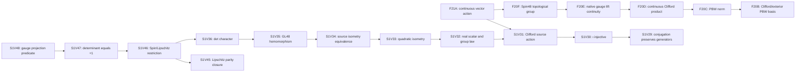
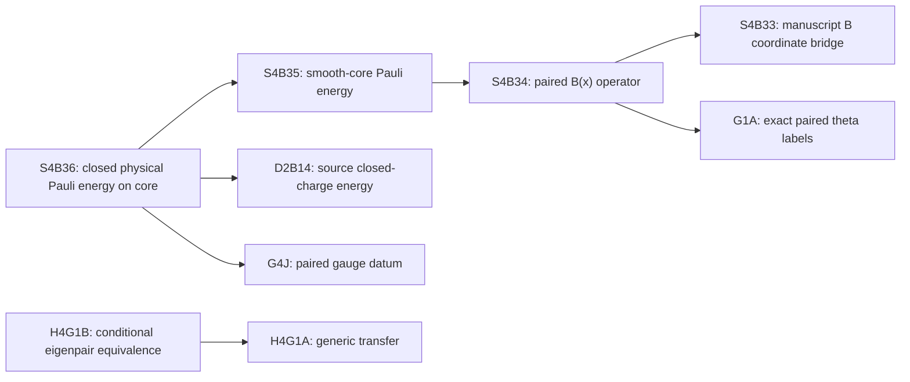
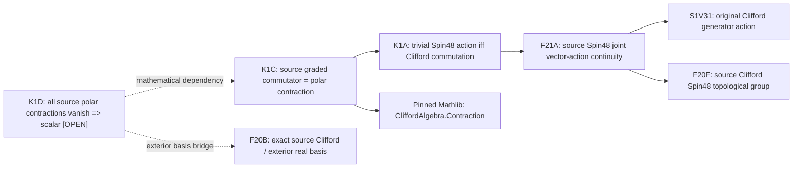

# FCP BFSS — live Lean dependency map and Project Lead reuse registry

**Created:** 2026-10-27 · **Scope:** BFSS research branch · **Classification:** workflow/navigation aid, **not** a theorem certificate or a claim of completed physical BFSS spectral verification.

> Seek truth about reality. Preserve results, not theories.

## One-source-of-truth rules

- The **actual `.lean` files** are the canonical source for direct `import` edges. Regenerate graph views with [`tools/bfss_dependency_graph.py`](../tools/bfss_dependency_graph.py); do not manually synchronize a second complete import list.
- The **strict acceptance audit and original GitHub Actions evidence** remain authoritative for proven declarations. [`meta/bfss-dependency-qualification.json`](bfss-dependency-qualification.json) is a *small, explicitly non-exhaustive* set of source-blob-pinned evidence pointers for especially reusable nodes, not a replacement for the historical audits.
- An `import` is a **potential dependency**, not proof that a given declaration uses another theorem, not evidence the imported module's original gate was green, and not authority to promote a generic statement into the original physical model.
- A file header saying `STAGED`, `UNCOMPILED`, or `UNQUALIFIED` is historical text; current acceptance must be determined by an exact statement, source blob, and strict completed evidence.
- An original accepted Lean theorem is a mathematical statement under its actual hypotheses, not automatically a physical eigenstate-existence theorem.

## Reusable Spin(48) foundation — *actual* import structure

Arrows point **from importing module to its imported prerequisite**. This is a human-readable subset of the generated graph; use the generator for deeper direct ancestry, reverse dependents, complete paths, and current Git blobs.



**Directly reusable theorem interfaces (check exact acceptance):**

| Module(s) | Source-grounded capability | Qualification caution |
|---|---|---|
| S1V29–S1V32 | Generator preservation; `ι` injectivity; real-linear source action with identity/composition | Use literal `Source48Vector`, not an assumed alternate 48-label flattening |
| S1V33–S1V35 | Preserves original `source48Quadratic`; real linear equivalence and group hom | Isometry / GL hom **does not** prove SO image or covering |
| S1V36–S1V47 | Determinant character and exact +1 orientation via Lipschitz parity | Do not rerun determinant work; use S1V47 and check its historical accepted proof |
| F20B–F20F | Real-linear PBW basis, finite-dimensional topology, Clifford multiplication / Spin inversion continuity | `CliffordAlgebra.equivExterior` is **linear, not multiplicative** |
| F21A | `originalSourceCliffordGenerator_closedEmbedding`; `originalSourceSpin48VectorAction_joint_continuous` | Two strict roots, [Actions #40484231446](https://github.com/etblink/Foundational-Convergence-Program/actions/runs/40484231446); no covering proven |
| S1S / S1T | Genuine source `sourceSpinPair`; two-plane action facts | Rotor-surjectivity needs an explicit all-vector reflection-pair bridge; verify module-gate qualification |
| S1V3 | Source/standalone rotor and vector-space identity candidate | Inspect actual accepted root provenance before reusing; do not trust its old staging header |
| L9D9 | Native sixteen-block Spin lift covers actual gauge Majorana matrix | This is the **gauge** `SU(2)` lift, not the missing spatial `Spin(9)` lift |
| L9E5F14–F15 | Native Fock representation group-law interface | Confirm full original Fock/CAR implementation and strict acceptance before treating as physical symmetry |

## Physical source bridge and spectrum — *actual* import structure



This is **not** a proof that the S4 path is an import ancestor of H4G1B. Rather, they are independently qualified interfaces that a future complete physical/spectral argument must reconcile. The `H4G1B` theorem is an **equivalence conditional on an eigenpair**, not an existence result.

## Missing results — the actual critical path

1. **KERNEL-PBW-1:** Prove an ordered distinct-source Clifford monomial to F20B exterior-basis coefficient interface, then the even Clifford commutant is scalar. Pinned Mathlib `Contraction.lean` has `changeForm_ι_mul` with a bilinear correction term. The current genuine source Spin(48) kernel `{+1,-1}` remains an **unqualified mathematical target**; see [kernel-first scoped audit](../audits/FCP_BFSS_SOURCE_SPIN48_PROJECTION_KERNEL_AND_COVERING_FIRST_BOUNDED_ANALYSIS_2026_10_27.md).
2. **Source SO projection:** Package the accepted source Q-isometry and determinant-one maps as an SO(48) homomorphism without changing original coordinates or conventions.
3. **Image / covering:** Use the true `S1S` source pair-rotor and Cartan–Dieudonné / an appropriate qualified fixed-source reflection factorization for surjectivity, then prove compactness/openness or local covering from actual topology. A finite kernel alone does not give a covering.
4. **Actual global Spin(9) lift:** Check source `pairedLabelEquiv` Fock-mode ordering; center sign; genuine Fock/CAR implementation; exact SU2 gauge commutation and bosonic/spatial action.
5. **Physical form and spectral completion:** Establish original closed form symmetry, isotypic reducing projections, source-fixed Spin(8) oscillator exclusion, uniform gauge-physical coercivity, compact-resolvent sector, nonzero infinite-dimensional physical sector and actual positive normalizable eigenvectors. No step is discharged solely by the earlier ones.

## Rebuild, query, and maintain

From a clone checked out at the intended research branch HEAD:

```bash
# Inventory the entire BFSS local Lean corpus, including recovery subdirectories.
python3 tools/bfss_dependency_graph.py

# Print a source-derived Markdown/Mermaid graph of F21A's 4-level prerequisites.
python3 tools/bfss_dependency_graph.py \
  --focus SU2BFSSPhysicalDomainS1V52L9E5F21AOriginalSpin48SourceVectorActionJointContinuityProbe \
  --direction deps --depth 4 --format markdown

# Who depends on the already accepted S1V30 source injector?
python3 tools/bfss_dependency_graph.py \
  --focus SU2BFSSPhysicalDomainS1V30Real48CliffordGeneratorInjectiveViaExteriorProbe \
  --direction dependents --depth 2 --format dot

# Fail closed if any manually linked accepted source blob has changed.
python3 tools/bfss_dependency_graph.py --check-evidence
```

The generator scans every `.lean` file under the two experimental trees, indexes imports, and emits `markdown`, `mermaid`, `dot`, or `json`. Import names that are absent from these trees are treated as **external/unresolved**, not silently assumed qualified; ambiguous local basenames stay explicitly unresolved. For full source-tree integrity use the committed Git snapshot and exact source Git blobs, not a generated snapshot copied forward across source changes.

**Maintainability rule:** Update the small receipt manifest only after examining the completed strict run, exact declaration list, allowed axioms, imported source closure and candidate Git blob. If a candidate source is modified, the receipt must fail blob validation until requalified. Never automatically mark a module accepted merely because its file exists or imports passed. Keep failed-gate provenance in the original dated audit, not duplicated in this registry.

**Active Project Lead checkpoint:** F21A two accepted roots; S4 separate accepted family 63; this dependency-map operation is navigation/infrastructure only and adds **0 theorem roots**. Frozen original mathematics, canonical `main`, and scientific publication scopes are unchanged.

### First actual graph-integrity qualification — October 27, 2026

[GitHub Actions #40489118724](https://github.com/etblink/Foundational-Convergence-Program/actions/runs/40489118724), job `122138292530`, **strictly green for this static tooling scope**. The original job log reports `Indexed 842 local Lean files` (including the recovery subtree), `Verified 7 Git blob qualification pins`, a generated F21A import-ancestry Mermaid graph, and `BFSS_SOURCE_IMPORT_GRAPH_AND_QUALIFICATION_PINS_PASS_NO_LEAN_ROOTS`. This verifies the graph tool executed on the actual research checkout and its curated source-pins matched the current checked-out files. It is **not** a Lean kernel compilation or proof-acceptance certificate; new mathematical roots **0**.


## K1A accepted source leaf — October 27, 2026

[Strict CI Gate #40491802270](https://github.com/etblink/Foundational-Convergence-Program/actions/runs/40491802270) accepted one new source-exact Lean theorem in SU2BFSSPhysicalDomainS1V52K1AOriginalSpin48KernelCommutantProbe.lean, Git blob 5d1117d1f469a3a76a78c3c4ae4b8896b18b1b7a:

**FCP.BFSSS1V52K1A.originalSourceSpin48_trivialAction_iff_generator_commutes**

Source-import ancestry: K1A → F21A → S1V31 and its S1V30 ancestors, with F20F through F21A. The theorem says trivial original Spin(48) vector action is equivalent to commuting with every original Clifford degree-one generator. Its only reported axioms are propext, Classical.choice, Quot.sound. The source gate compiled freshly, produced a nonempty binary and saved a hash-qualified cache. It does NOT prove the even Clifford commutant scalar, full two-sign kernel, image, or covering. The curated acceptance manifest now includes this eighth source identity.

**K1B is separately staged and unqualified:** SU2BFSSPhysicalDomainS1V52K1BOriginalSpin48NegativeCentralSignProbe.lean consumes K1A and historically accepted S1S rotor, but the F21A cache does not contain the compiled S1S binary. Recover compatible exact S1S ancestry before any K1B strict gate. Do not conflate an accepted theorem with binary availability. Preserve failure causes in [the K1A gate-cycle audit](../audits/FCP_BFSS_K1A_SOURCE_SPIN48_KERNEL_COMMUTANT_GATE_CYCLE_2026_10_27.md).

**Next mathematical target:** original 48-label ordered Clifford/exterior PBW coefficient interface, then even commutant scalar. The exact pinned changeForm_ι_mul contains the contraction correction; never treat equivExterior as multiplicative. Independent physical/spectral adversarial work remains open.


### Latest generated graph qualification after K1A/K1B source split

[GitHub Actions #40492708297](https://github.com/etblink/Foundational-Convergence-Program/actions/runs/40492708297), job 122150366622, completed success on October 27, 2026. Actual run log: **844** BFSS Lean files indexed (including recovery); **8** reviewed source-blob acceptance receipts verified. The earlier 842-module statistic above is a correct *prior* checkpoint, superseded for current inventory size by 844. This CI adds **zero** Lean theorem roots. The one new K1A mathematical root was separately qualified by [#40491802270](https://github.com/etblink/Foundational-Convergence-Program/actions/runs/40491802270).

## K1C strict source polar contraction acceptance — October 27, 2026

**[K1C Actions #40494768705](https://github.com/etblink/Foundational-Convergence-Program/actions/runs/40494768705), job 122157309697, completed strict green: 3/3 fresh theorem roots.** Exact accepted source module `SU2BFSSPhysicalDomainS1V52K1COriginalSpin48CliffordPolarContractionProbe.lean`, blob `7334a3616740b902c9e42231efc97ed7566ad8c2`. Pinned K1A accepted parent restored; only `propext`, `Classical.choice`, `Quot.sound` reported, nonempty new binary saved. No physical theorem promoted. Curated source-evidence manifest now has **nine** reviewed pins.



The K1D dotted edges represent **mathematical requirements not current Lean imports**; the solid edges are actual direct source import links. Source exact quadratic polarization from S1V38 (`polar Q a b = 2*(a ⬝ᵥ b)`) is a reusable original-source qualification candidate to recover by precise binary ancestry rather than reproving or assuming an unrelated Euclidean identification.

**Next proof gate:** prove via the existing F20B real-linear exterior basis that annihilation by all coordinate contractions kills every positive exterior-degree coefficient. `changeForm_contractLeft` permits linear contraction transport without illicitly treating `equivExterior` as an algebra homomorphism. Then use positive original Q to show the original polar functionals span the required coordinate duals. **No new Spin48 `{±1}` kernel theorem until that separation and K1B negative central sign are strictly qualified.**

[Complete K1C Gate 1 red → Gate 2 green audit](../audits/FCP_BFSS_K1C_ORIGINAL_POLAR_CONTRACTION_REDUCTION_2026_10_27.md).
